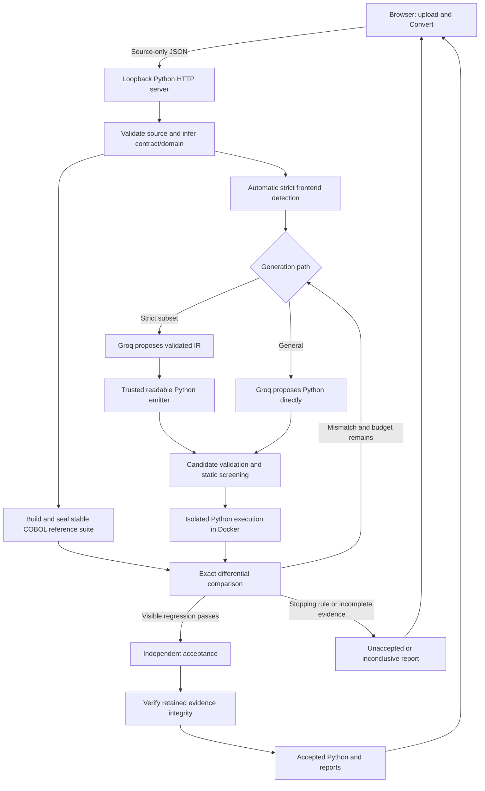

# Legacy Diff — implementation and progress summary

Snapshot: 18 November 2026. This describes implemented behavior and recorded results; it does not claim universal COBOL support.

## Upload-only interface update

The browser input panel now contains only the COBOL file picker and Convert button. Groq with `openai/gpt-oss-120b` is selected on the server. Program type, provider, model and test-domain controls are not exposed. The output panel and its downloads remain unchanged.

The server infers the input domain and tries the strict console, report and decimal extractors. A strict path is selected only if its complete extractor accepts the source and contract; otherwise General AI attempts direct Python generation. Inferred domains are explicitly labelled automatic and not manually reviewed in the manifest. This convenience interface does not establish business-domain completeness.

### What can be attempted

- Single ASCII COBOL source files up to 128 KiB, in detected fixed or free format, compiling with the pinned GnuCOBOL environment.
- No-input console output, including the strict literal DISPLAY subset.
- Self-contained variables, arithmetic, internal paragraph PERFORM, conditions, EVALUATE and loops through General AI. ARITH-LOOP has a verified accepted run.
- Plain line-based stdin ACCEPT with automatically inferred bounded integer/text cases. Conditional or repeated input is attempted, but inference is incomplete and successful finite tests do not establish full input coverage.
- Strict supported report-writer layouts and fixed-point decimal operations through validated IR, with General AI fallback when strict parsing does not match.
- File programs fitting the upload adapter: one input and one output with literal double-quoted ASSIGN names, a recognizable input FD and level-05 fields. Fixed-record character/integer fields are supported; the decimal adapter supports its bounded numeric storage forms.

### What this interface cannot handle or guarantee

- C or other target languages: output is Python only.
- Arbitrary COBOL dialects or constructs, all compiler extensions, or universal semantic equivalence.
- Multiple programs in one source, missing COPY books, multiple uploaded dependencies, or custom compiler/toolchain setup.
- Embedded SQL, CICS, external/dynamic CALL, object-oriented INVOKE/CLASS-ID, environment/device ACCEPT FROM, uncontrolled time/randomness and replacement/preprocessor directives blocked by screening.
- Live network behavior or databases/services: program containers have networking disabled and no dependency adapters are implemented.
- Combined file-and-stdin programs, arbitrary file layouts, multiple input/output files, indexed/relative database-style workloads, or binary/packed records through automatic upload-domain inference.
- Automatic exhaustive coverage of business rules, conditional/repeated ACCEPT protocols, all decimal input ranges or every branch. Use explicit CLI manifests/fixtures when the automatic domain is inadequate.
- Guaranteed successful generation: provider limits, unsupported parsing, compilation errors, mismatches or resource failures still stop the conversion. Only accepted results are released.

The upload simplification does not change the sandbox, exact comparison, repair budget or independent acceptance gates.

## Purpose

Translate COBOL into Python while checking that the translated program preserves observable behavior. The original COBOL program is the executable reference. AI proposes a candidate; the validator decides whether it matches.

Differential analysis compares executions, not source text. COBOL and Python source cannot meaningfully match byte for byte. We compare stdout, stderr, declared output-file contents and presence, and ordinary exit codes. Spaces, leading zeroes, trailing spaces, and line endings matter.

Python is the implemented target. C was discussed as a possible target but is not an implemented conversion path. Network-dependent programs require future adapters; execution currently disables networking.

## Workflow

1. Upload COBOL or choose a manifest through the CLI.
2. Validate source paths, format, dependencies, pinned toolchains and execution contract.
3. Infer a finite input domain automatically in the simplified browser; explicit CLI manifests allow domain review and configuration. A domain describes the inputs covered by testing.
4. Check Docker and the selected model/provider prerequisites.
5. Compile the original in Docker. Execute each reference case twice in fresh workspaces and reject unstable or incomplete references.
6. Freeze the source, plan, cases and expected observations into a sealed regression suite.
7. Ask the selected AI model for Python, or for a structured intermediate representation in a supported strict frontend.
8. Validate the response, paths, size, syntax and restricted operations before sandbox execution.
9. Execute the candidate in Docker and compare exact observables.
10. Feed bounded visible mismatches back to AI for repair. Stop on success, repeated failures/candidates, exhausted attempts, provider errors or incomplete validation.
11. After visible regression passes, independently evaluate fresh held-out cases. No-input programs instead receive independent singleton reexecution because there are no unseen input combinations.
12. Verify candidate and evidence integrity before presenting accepted Python. Retain reports for inspection and replay.

## Three translation paths

| Path | Role of AI | How Python is produced | Scope |
| --- | --- | --- | --- |
| General AI | Proposes and repairs Python directly | Model supplies a complete standalone file | Attempts broader arithmetic, variables, stdin, conditions and loops; success is measured |
| AI-proposed IR | Proposes and repairs structured program data | Validated IR is passed to trusted emitters | Supported console, report and fixed-point decimal subsets |
| Deterministic structured translation | No model call | Extract supported source into IR, then emit Python | Explicit strict subsets only |

IR means intermediate representation: structured data describing a program. It is not an acceptance result. The same differential gates apply to emitted Python. Deterministic translation is not counted as a successful AI generation run.

## System architecture

Legacy Diff is a local Python application with a browser client, an orchestration backend, an external AI generation service and isolated Docker execution. The browser is a thin client: it neither calls Groq directly nor executes uploaded/generated programs. The backend owns configuration, test construction, job state and evidence. The reference program, not the model, defines expected behavior.

### Architecture layers and boundaries

| Layer | Implementation | Responsibility |
| --- | --- | --- |
| Presentation | `web.html` | File selection, conversion submission, progress polling, output and downloads. |
| HTTP/application | `web.py` | Session/origin checks, request limits, server defaults, job lifecycle and workflow dispatch. |
| Contract and domain | `manifest.py`, `preflight.py`, `cases.py`, `stdin_cases.py` | Validate what will run, its environment and the finite test inputs. |
| Translation | `generation.py`, `hosted.py`, `ai_ir.py`, strict frontend modules, `readable.py` | Propose artifacts, validate their shape and produce candidate Python. |
| Execution | `execution.py`, `monitored_execution.py`, `supervisor.c` | Compile/run programs in Docker and capture complete observations/resource evidence. |
| Validation | `comparison.py`, `suites.py`, `acceptance.py` | Own reference expectations, exact comparisons and final acceptance decisions. |
| Evidence lifecycle | `inspection.py`, `resume.py`, `coordination.py` | Verify/replay retained results, preserve follow-up lineage and coordinate access. |

The generation service cannot authorize acceptance or edit expected observations through its response. Visible regression feedback may be used for repair; private held-out cases are not included in generation prompts. Docker containers receive program inputs, not the evaluator's private expected-output store. Hashes identify artifacts and detect modification; they are not a substitute for access control.

## Frontend details

### Technology and visible controls

The frontend is a single HTML page with inline CSS and vanilla JavaScript. It does not require React, a frontend build server or a browser-side AI SDK. Its responsive two-column layout places the source upload on the left and the existing conversion result panel on the right.

The simplified input side exposes only a COBOL file picker and the Convert button. The picker accepts COBOL/plain-text extensions; the browser checks file size and emptiness, while the server performs authoritative source validation. Provider, model, program category and test-domain controls are hidden from the user because these choices are now made internally.

The result side retains its status, diagnostic message, accepted Python preview and report download controls. Python is displayed as text, not executed by the browser. Failed conversions do not publish an accepted Python download.

### Browser request lifecycle

1. JavaScript reads the selected file into source text and enables Convert.
2. Convert sends `{source: ...}` as JSON to `POST /api/convert`, with the session token injected into the served page.
3. The server responds with a job identifier. Controls are disabled while that conversion is active.
4. JavaScript polls `GET /api/jobs/<id>` approximately every 1.5 seconds and renders progress or errors.
5. A terminal Complete or Stopped state restores controls. Accepted code appears only for a completed accepted job.
6. Download buttons fetch available evidence through authenticated job endpoints and create browser download links.

The browser never receives `GROQ_API_KEY`. It communicates with the local backend, and that backend contacts Groq. Uploaded source and visible repair context are therefore sent to the configured hosted service. Refreshing loses the page's current job selection, although evidence remains on disk.

## Backend details

### Server and API

The backend uses Python's standard-library `ThreadingHTTPServer` and `BaseHTTPRequestHandler`. It binds to `127.0.0.1` by default on port 8765. It validates local session tokens and request origins/host details; this is a local application rather than a production public hosting service.

| Endpoint | Purpose |
| --- | --- |
| `GET /` | Serve HTML with a generated session token. |
| `GET /api/config` | Report credential-availability booleans; never return credentials. |
| `POST /api/preview` | Existing explicit configuration/domain preview API; not used by the simplified upload page. |
| `POST /api/convert` | Accept source-only browser requests, assign internal defaults and start a conversion job. |
| `GET /api/jobs/<id>` | Return job status, outcome, diagnostics and accepted code when available. |
| `GET /api/jobs/<id>/<artifact>` | Download allowed Python/report/manifest artifacts for that job. |

Request bodies are bounded at 256 KiB and source at 128 KiB. A UUID identifies each job and its new directory under `runs/web/`. A background thread performs conversion so HTTP polling stays responsive. A lock protects shared job state, and only one conversion runs at a time per server. Separate OS coordination protects participating generation/evidence workflows across processes.

### Automatic configuration and routing

Source-only requests internally select `frontend=auto`, provider Groq and model `openai/gpt-oss-120b`. Source line endings are normalized before saving. The backend drafts a manifest using inferred source format, input/output declarations and stdin fields. The draft attempts general input recognition and a decimal-record configuration where needed; unsupported input shapes stop rather than inventing external dependencies.

After loading the plan, `automatic_frontend()` tries the complete strict console, report and decimal extractors in that order. An extractor must accept the actual source and contract before its AI-IR path is selected. If none accepts, General AI generates Python directly. Routing is based on supported parsing, not on an AI label or a filename guess. Even fallback cannot bypass manifest screening, compilation, the upload input adapter or acceptance gates.

The inferred domain is marked automatic and not manually reviewed in its description. The manifest's existing reviewed flag remains an internal admission field; it must not be interpreted as a claim that a person reviewed this browser-generated domain. For meaningful business-domain review or custom fixtures, use an explicit CLI manifest.

### Generation, execution and acceptance

The backend first builds a sealed suite from repeated stable COBOL executions. It then invokes direct generation or AI-IR generation using Groq. Candidate validation rejects malformed, oversized, truncated or restricted artifacts before execution. Direct generation records attempts, candidate hashes, visible feedback and stopping reasons, with a maximum of five attempts for the current browser defaults.

Reference and candidate execution use pinned Linux Docker images, controlled environment settings, networking disabled and bounded execution resources. The monitor distinguishes ordinary nonzero exits from timeouts, signals, resource exhaustion and incomplete capture. Exact comparison never converts an incomplete execution into a pass simply because both programs failed similarly.

Visible regression success produces `awaiting_acceptance`, not accepted. Acceptance freezes the candidate and independently evaluates fresh held-out cases where possible, or independently reexecutes no-input singleton programs. The web backend then calls `verified_acceptance()` before publishing `converted.py` and the code preview.

### Storage and deployment

Job state is held in process memory, while source, manifests, suites, candidates and reports are retained on local disk. There is no application database or distributed job queue. Restarting the server loses active in-memory job tracking; it does not delete retained evidence. Git ignores run directories and secret environment files.

Start the backend with `python -m legacy_diff.web` in a shell containing `GROQ_API_KEY`, with Docker's Linux engine and pinned images available. Python source changes require a server restart; refresh the browser afterward. Current deployment is for a trusted local user, not a multi-user Internet service.

## Source-code map

| File | Responsibility and important behavior |
| --- | --- |
| `legacy_diff/__main__.py` | Enables `python -m legacy_diff` and delegates to the command-line interface. |
| `legacy_diff/__init__.py` | Package initialization. |
| `legacy_diff/cli.py` | Dispatches check, compare, suite, translate, structured/AI translation, accept, resume, inspection and replay commands. Emits structured reports and command-specific exit statuses. |
| `legacy_diff/manifest.py` | Loads YAML without silently accepting duplicate keys, validates schema and paths, resolves source/copybooks, screens unsupported features, and constructs the hashed execution contract. `load_plan()` is the main entry point. |
| `legacy_diff/preflight.py` | Checks Linux Docker availability, pinned local image identity and toolchain versions. Checks local Ollama model identity or delegates hosted readiness. Readiness is not an inference or compatibility guarantee. |
| `legacy_diff/cases.py` | Validates supported input generators, serializes fixed-record fields, classifies cases and constructs deterministic regression inputs. Uses seeds and content identities for reproducibility. |
| `legacy_diff/stdin_cases.py` | Builds reviewed line-oriented stdin cases from integer bounds or finite text choices. Covers boundaries and seeded samples; validates field counts, ranges and encoding. Conditional/repeated ACCEPT sequences still require careful domain review. |
| `legacy_diff/execution.py` | Provides shared execution utilities, inventory and verified copying, public execution records, and direct reference-versus-candidate comparison orchestration. |
| `legacy_diff/monitored_execution.py` | Implements the Docker executor, framed output capture, bounded workspace export and resource-evidence handling. Separates normal program exits from timeout, signal, capture and infrastructure failures. |
| `legacy_diff/supervisor.c` | Trusted Linux supervisor used inside the execution environment to monitor child execution and resource/syscall events. It is harness code, not generated translation code. |
| `legacy_diff/comparison.py` | Compares exact streams, file presence/content and exit codes. Computes first mismatch offsets and bounded layout diagnostics. Includes a bounded candidate stderr tail so repair sees runtime exceptions at the end of tracebacks. |
| `legacy_diff/suites.py` | Builds and verifies frozen reference suites, repeats references to check stability, seals identities, and checks candidates against the retained suite. `build_suite()`, `verify_suite()` and `check_suite()` are central operations. |
| `legacy_diff/generation.py` | Builds source/repair prompts, calls the adapter, validates the one-file response, screens syntax and restricted operations, writes candidates, runs visible regression and enforces stopping rules. Retains attempt provenance. Narrowly repairs a single extra JSON escaping layer only when original source is invalid and one strict decode yields valid Python. |
| `legacy_diff/hosted.py` | Implements Hugging Face and Groq transport with fixed endpoints, environment-based credentials, redacted evidence, response checks and explicit provider errors. Groq calls are paced; failed calls are not automatically retried or silently sent elsewhere. |
| `legacy_diff/ai_ir.py` | Requests AI-proposed IR, validates schema and supported semantics against the strict source frontend, emits Python, and repairs using visible regression feedback. |
| `legacy_diff/structured_console.py` | Detects source format and handles a bounded literal DISPLAY console subset. Emits ordinary Python, such as `print('Hello, World!')`, while preserving supported newline/exit behavior. |
| `legacy_diff/structured_report.py` | Extracts supported report definitions, record fields, columns and page layout into validated IR; orchestrates deterministic structured translation. |
| `legacy_diff/structured_decimal.py` | Extracts supported fixed-point DISPLAY arithmetic, receiving-field precision, rounding and SIZE ERROR behavior. Rejects constructs outside its strict grammar. |
| `legacy_diff/readable.py` | Emits direct, named Python statements from report and decimal IR. Keeps compatibility helpers where necessary for COBOL numeric/storage behavior rather than interpreting an embedded IR at runtime. |
| `legacy_diff/acceptance.py` | Freezes the candidate, verifies regression completeness, builds independent private held-out cases, checks reference stability and resource evidence, and issues the final decision. Excludes previously exposed cases in follow-up lineages. |
| `legacy_diff/resume.py` | Verifies parent evidence and starts an explicit new follow-up run. Exposed failures become visible regression, fresh held-out evidence is used, and parent artifacts are preserved. |
| `legacy_diff/inspection.py` | Summarizes reports, verifies retained acceptance/visible evidence and replays supported runs in new directories. Replay checks reproducibility; it is not a new AI generation or acceptance claim. |
| `legacy_diff/coordination.py` | Uses a per-user OS lock to prevent participating generation and evidence operations from conflicting. The operating system releases the lock after process exit. It is coordination, not protection against a privileged local user. |
| `legacy_diff/web.py` | Local HTTP server and conversion-job orchestration. Prepares manifests/domains, runs background conversion, invokes acceptance, verifies evidence and serves permitted downloads. API keys remain in server environment variables. |
| `legacy_diff/web.html` | Browser upload form, program/provider/model selection, editable domain review, progress display, error messages and result/report download controls. |

Generated Python is never imported or executed directly on the host. Static AST parsing is a syntax/restriction check, not a proof of safety or correctness; Docker and execution controls provide the implemented isolation boundary.

## Other project directories

- `examples/`: sample COBOL, manifests, input fixtures and documented upstream attribution. Includes report-writer, decimal and console examples.
- `tests/`: automated tool tests for contract validation, execution, comparison, suites, generation, hosted transport, acceptance, resume, replay, strict frontends, readable emission, stdin and UI.
- `scripts/`: reproducible verification entry points, including ticket checks, structured/decimal fixture verification and `verify_ai_ir.py` for suite → AI IR → acceptance.
- `docs/`: specification, architecture, decisions, command guides and verification records. Historical verification records describe results at their recorded point in time.
- `.scratch/cobol-to-python/`: ticket plan and issue records.
- `runs/`: ignored evidence, prompts, candidates, suites and reports. Fresh output directories are required so earlier evidence is not overwritten.
- `plugins/`: bundled Matt Pocock workflow skills, separate from the conversion engine.

## Problems, diagnoses and changes

| Problem | Cause/evidence | Change or operational resolution | Remaining limit |
| --- | --- | --- | --- |
| Missing `manifest.yaml` | Command referenced a nonexistent file | Used the actual example path and prepared a real manifest | Paths must still exist |
| Template image rejected | Placeholder was not a repository digest | Configured real `repository@sha256:...` references | Tag-only images are intentionally insufficient |
| Toolchain unavailable | Local image identity/version did not match the plan | Prepared pinned images and corrected declared observed compiler version | Readiness deliberately does not pull images silently |
| Docker HTTP 500 or missing Linux pipe | Desktop engine unavailable even when application appeared open | Restarted/recovered Docker and repeated live checks | Docker availability remains an external prerequisite |
| 27B model out of memory | CPU/host allocation failed; GPU availability did not guarantee sufficient capacity | Authorized switch to installed 7B model; explored cloud CPU and hosted APIs | Listing a model does not prove it can complete generation |
| CPU cloud generation timed out | Inference remained busy beyond request timeout | Investigated runtime/resources; added hosted alternatives | No claim that waiting indefinitely guarantees a usable response |
| Output directory already exists | Evidence directories are immutable per run | Used a new output-directory name | This safeguard remains intentional |
| Missing suite seal | Suite build failed or translation referenced the wrong directory | Require a successful sealed suite before translation | Failed reference preparation cannot be bypassed |
| Hugging Face HTTP 402 | Hosted account/provider rejected the request for payment/credit reasons | Added explicitly selected Groq support | Hosted free quotas and availability remain provider-controlled |
| Hosted 403/503/429 | Access denial, capacity or rate limit | Added bounded redacted error evidence, clearer diagnostics and Groq pacing | No automatic fallback or unlimited retries |
| Repair context too large | Source and accumulated feedback exceeded local admission budget | Bounded/compacted visible feedback and used a larger hosted context allowance | Oversized requests still stop explicitly |
| Groq JSON validation 400 | Provider rejected constrained JSON generation | Groq now requests ordinary completion text; local artifact JSON validation remains strict | Models can still return invalid artifacts |
| Doubly escaped Python | Source contained literal `\n`/escaped quotes after envelope decoding | One narrowly checked extra JSON-string decode, with provenance; valid source is unchanged | Not a general source-rewriting or recursive decoding mechanism |
| GPT-OSS returned no code at token cap | 4,094 of 4,096 tokens were reasoning in one retained response | Set low reasoning effort and an 8,192 completion budget for Groq GPT-OSS direct generation; improve truncation diagnostics | Completion can still be exhausted and is then rejected |
| Hello World output looked unnecessarily complex | Earlier emitted file embedded IR/runtime logic | Emit direct readable statements; report/decimal output also moved toward named direct statements | Compatibility helpers remain where needed |
| Plain ACCEPT rejected | Initial console subset had no input support | Added General AI path and reviewed stdin-line generation | External/environment ACCEPT and complex input protocols need adapters/review |
| Mixed indentation misdetected as fixed format | Detector used only the first meaningful line | Inspect all meaningful lines when inferring source format; add regression test | Genuine fixed-format constructs remain governed by their support checks |
| Numeric PIC output mismatch | Model miscounted edited width and reused another field's format | Strengthened generic instructions: count punctuation positions; V has no stored position; each operand uses its own PIC | Prompt improvements are not correctness guarantees |
| Repeated generated IndexError | Formatting helper indexed beyond a short string | Exposed bounded stderr tail in repair feedback so the exception is visible | A fresh model repair and validation are still required |
| Opaque UI stop messages | Only stop-rule name was displayed | Show latest diagnostics or remaining failed-case/difference counts | Reports remain the detailed source of evidence |
| Replay reported timing drift | Wall-clock timestamps/durations naturally changed | Excluded those fields from replay equivalence while retaining raw timing evidence | Behavioral/resource/integrity changes remain meaningful |
| Concurrent evidence operations conflicted | Multiple participating processes accessed shared evidence workflows | Added OS-level coordination lock | Run coordinated workflows sequentially |

## Recorded achievements and current status

- Manifest checks, Docker comparison, frozen suites, bounded generation/repair, independent acceptance, explicit resume, inspection and replay are implemented.
- Local Ollama, Hugging Face and Groq generation adapters exist. Provider selection is explicit; no hidden model substitution.
- Browser upload, reviewed domain preparation, conversion status and report/download access are implemented.
- A real Groq GPT-OSS report AI-IR run was recorded as accepted with integrity verified. Other examples, including readable console output and a corrected retained AI sum candidate, also passed recorded differential/acceptance checks.
- The sum candidate acceptance followed one transport-decoding correction, not a new model generation or manual rewrite of its logic.
- The ticket 8 commit passed 192 tests. After the upload-only interface update, the full suite passed **193 tests**; the final HTTP file-only dispatch check also passed in the seven-test interface suite.
- Strict readable report/decimal live validation was previously deferred during Docker problems; do not infer completion from unit tests alone.
- Earlier `ARITH-LOOP` candidates crashed with an IndexError in numeric-formatting code; traceback-aware repair feedback was added.
- The later real General AI `ARITH-LOOP` run at `runs/web/3aec96fcaa6540cbaa2e7c0bccd21b4a` is **accepted**. Its retained source was checked and its acceptance evidence passed `verified_acceptance()` on 18 November 2026. This establishes compatibility for the recorded no-input case, not universal equivalence.

## What the arithmetic example actually tests

The source hardcodes price 12.50, quantity starting at 1 and five iterations. Its reference computes subtotal 187.50, discount 5.00 and grand total 182.50. Numeric values alone are insufficient: the edited totals include field padding, and the unedited discount's implied decimal is not printed as a decimal point.

There is one no-input case, independently repeated. This does not exercise other discount branches or different prices/counts. To measure those paths, introduce reviewed inputs or separate source fixtures. Do not describe singleton reexecution as unseen-input coverage.

## Immediate next work

1. Preserve the accepted `ARITH-LOOP` candidate and its verified local evidence.
2. Use the accepted example as a baseline for future regression checks.
3. Add input-driven variants to measure branches beyond its fixed constants.
4. Broaden examples to cover discount thresholds, zero values, rounding, overflow, branches and loops using reviewed input domains or fixtures.
5. Complete deferred live readable report/decimal validation when Docker is available; the current full automated suite has passed.

Matching finite tests supports a bounded compatibility claim, not universal equivalence. Equal timeouts, incomplete capture or missing monitoring evidence do not qualify as a match. Git staging, commits and pushes require the user's explicit consent.
